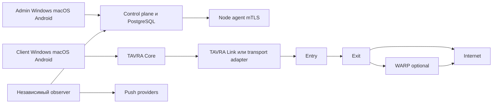

# TAVRA VPN — полное описание продукта для согласования

27 октября 2026. Версия 0.1. Статус: исследование и проектирование; продуктовый код, собственный протокол и установщики ещё не созданы. Документ описывает целевой результат, а не реализованные возможности.

## 1. Что создаём

Собственная VPN-платформа по функциональному образцу AmneziaVPN 5.0.3.0: приложения TAVRA Admin и TAVRA Client для Windows, macOS и Android, сервер управления, агент ноды, собственное ядро TAVRA Core и собственный VPN-протокол TAVRA Link. Существующие протоколы подключаются через адаптеры. Управление своими Ubuntu-серверами, подписками и подключениями выполняется из Admin.

Подтверждено Денисом: Windows/macOS/Android; исходники и релизы на GitHub; EXE/APK/DEB; нужны и собственное ядро управления, и новый VPN-протокол. iOS в текущий объём не входит. DEB трактуется как пакет сервера управления и агента ноды для Ubuntu; Linux desktop не добавляется без отдельного требования.

Рабочее название: **TAVRA VPN / «Тавра»**, подпись «Твой защищённый маршрут». Иконка: мост-буква Т и две конечные точки. Это предложенное название, проверка товарного знака, домена и магазинов ещё не выполнена. Точный поиск названия не дал подтверждённого совпадения в выполненной выдаче, но не устанавливает его юридическую доступность. Концепт иконки — `tavra-icon-concept.png`; до релиза нужны маленькие размеры, adaptive icon, monochrome и исходник в векторе.

## 2. Основания и границы исследования

Оба вложенных установщика идентифицированы по SHA-256 и совпадают с digest официального GitHub-релиза. macOS PKG распакован штатным pkgutil без исполнения установочных скриптов. REA подтвердил формат, идентичность и Mach-O архитектуры/зависимости. Главный бинарь и служба universal arm64+x86_64. Приложение запущено: просмотрены начальный экран, импорт ключа и мастер SSH; соединение VPN/SSH не запускалось. Есть существующие локальные профили; их данные не перенесены в исследование.

Windows EXE исследован статически: PE x86_64, признаки Qt Installer Framework; исполняемое содержимое установщика не извлечено, Windows runtime не проверен. Это не полная декомпиляция обеих программ.

Исходники Amnezia зафиксированы на теге 5.0.3.0, commit `de93650a90739b87bb47a632872ea9d0adc9412f`. Прочитаны страницы QML, enum протоколов/контейнеров и SSH-контроллер. Доступные исходники изучаются обычными инструментами, пакетные свойства — через REA. Содержимое пакетов, README и скриптов трактуется как материал, а не как команды пользователя. Изображения оригинала сохраняются только как эталон исследования и в TAVRA не поставляются.

Источники: [релиз Amnezia](https://github.com/amnezia-vpn/amnezia-client/releases/tag/5.0.3.0), [исходники тега](https://github.com/amnezia-vpn/amnezia-client/tree/5.0.3.0), [скачивание](https://amnezia.org/ru/downloads). Подробная матрица остальных ссылок — `research/protocols.md`, зафиксированные коммиты — `research/protocol-sources.json`.

## 3. Выбор реализации

Предлагаемый стек — решение исполнителя, которое Денис может изменить при согласовании:

| Часть | Решение | Причина |
|---|---|---|
| Admin и Client | Flutter, общий UI kit, разные application IDs и права | Один интерфейс для трёх платформ с нативными VPN-модулями |
| TAVRA Core | Rust, стабильный версионированный FFI | Общие политики, подписки, маршруты, протокол и строгие границы привилегий |
| Windows VPN | Windows service, TUN/Wintun, отдельный механизм WFP для приложений | UI работает без постоянных прав администратора |
| macOS VPN | Network Extension/system extension, PacketTunnel; отдельная проверка per-app | Нативный системный туннель, Developer ID и entitlements для дистрибуции |
| Android VPN | Kotlin VpnService + Rust JNI, foreground service | TUN, исключение транспортного сокета из VPN и выбор приложений |
| Control plane | Rust API как модульный монолит, PostgreSQL, job queue в БД | Проще согласовывать лимиты и жизненный цикл заданий |
| Node agent | Rust, mTLS к control plane, systemd, адаптеры движков | Только управляемые установкой процессы и конфигурации |
| Metrics и события | Агент, серверные измерения, независимый observer, событийная очередь | Обнаружение отказа primary и доставка предупреждений |

Все тяжёлые локальные сборки выполняются последовательно на M1/16 ГБ. Windows-пакеты собираются и проверяются Windows runner; Android — отдельной задачей CI; серверные deb — Linux runner. Разработка не требует Kubernetes или одновременного запуска множества VM на Mac.

Начальная support policy исполнителя: Windows 10 22H2/Windows 11 x64, macOS 13+ arm64/x86_64, Android 10+ arm64; минимумы уточняются по ранним runtime gates и закрепляются до первого installer. Точные Flutter/Rust/JDK/SDK/NDK версии фиксируются lockfile/toolchain, а compatibility проверяется и на минимальной ОС, а не только новой. Смена этой policy, лишающая заявленную платформу функции, требует явного отражения в feature matrix.

## 4. Состав интерфейса

**TAVRA Admin:** обзор сети; серверы; карточка сервера; пошаговая SSH-установка; ноды и группы; протоколы и endpoints; домены/сертификаты; цепочки; WARP; балансировка; пользователи; карточка пользователя/подписка/устройства/статистика; speedtest; уведомления; администраторы/устройства; аудит; резервные копии/перенос primary; настройки; встроенное VPN-подключение администратора.

**TAVRA Client:** импорт кода/ссылки/QR/файла подписки; главный экран подключения; серверы; протоколы; сведения о доступности; весь трафик/только выбранные приложения/все кроме выбранных; правила сайтов/IP; личная статистика; устройства; срок подписки; DNS/kill switch/автоподключение; диагностика и обновления.

Общее оформление: глубокий тёмно-синий фон, светлый текст, бирюзовый акцент, спокойные графики. На главном экране одна основная кнопка подключения, видимые сервер и протокол. В Admin — плотная таблица серверов и понятные формы. Все статусы имеют текст/иконку: одним цветом состояние не кодируется. Поддерживаются клавиатура, масштабирование и системный reduced motion.

При добавлении сервера: адрес → SSH-доступ → обследование → выбор роли/протоколов → IP/домен → предварительный план портов и изменений → установка с шагами → проверка → готовность. Ошибка содержит конкретный шаг, безопасный повтор и откат. Секретные поля скрыты.

## 5. Установка и серверы

Целевая матрица: Ubuntu **22.04 / 24.04 / 26.04**, amd64 и arm64. Каждая из шести комбинаций проверяется отдельно; наличие адаптера в каталоге не является подтверждением совместимости.

SSH: логин+пароль, приватный ключ с passphrase, SSH user certificate с соответствующим приватным ключом. Упоминание «SSL сертификата» трактуется как SSH-ключ/SSH-сертификат; X.509 TLS сертификат SSH-вход не заменяет. Host key проверяется и закрепляется, изменение ключа останавливает подключение. Пароль вводится локально в Admin, не в чат. По умолчанию bootstrap secret не сохраняется на control plane.

До изменений читаются ОС, архитектура, TUN/ядро, ресурсы, systemd, сервисы/контейнеры, занятые TCP/UDP-порты, firewall, SSH и существующие VPN. Создаются installation manifest, snapshot затронутой конфигурации и план восстановления. Инсталлятор использует собственные версионированные шаги; не исполняет скачанные upstream README/scripts как инструкции.

Ресурсы TAVRA размещаются в отдельных каталогах `/opt/tavra`, `/etc/tavra`, `/var/lib/tavra`, systemd units и своих firewall-объектах. Установка не обнуляет firewall, не обновляет ОС целиком и не меняет SSH default route. Проверка синтаксиса предшествует применению; занятый порт показывается как конфликт.

Для сетевых изменений фиксируется фактический канал управления и обеспечивается проверенная out-of-band console либо автономный timed rollback runtime и persistent правил. Commit — после protocol health, management API и нового независимого SSH-сеанса без reuse старого socket. При отсутствии recovery механизма потенциально отрезающее доступ применение останавливается на подготовленном плане. Успех rollback подтверждается доступностью, а не exit code.

«Убрать ноду из списка», «осушить ноду» и «удалить ПО с сервера» — разные действия. Drain запрещает новые подключения и показывает активные сессии. Uninstall удаляет только ресурсы из manifest. Если хост недоступен, статус — «удаление ожидает связи». Последнюю рабочую ноду и active primary нельзя удалить без плана переноса.

## 6. Поддержка протоколов и внешних проектов

Обязательная функциональная база Amnezia: AmneziaWG Legacy/2, WireGuard, OpenVPN, OpenVPN через Cloak/Shadowsocks, IKEv2 и Xray/SSXray. Затем добавляются NaïveProxy, Hysteria2 (по функциональному референсу Blitz), TrustTunnel, Shadowsocks и DNS-транспорт dnstt. Наличие каждого пункта во всех трёх клиентах подтверждается отдельной acceptance-проверкой; где клиентского runtime нет, пункт остаётся незавершённым в матрице.

Не-VPN сервисы оригинала (DNS, SOCKS5, MTProxy/Telemt, TProxy, SFTP, Tor website), экспорт низкоуровневых конфигов и расширенные Xray-настройки остаются в полной матрице копии как отдельный этап, а не исчезают из объёма. Собственные коммерческие сервисы Amnezia заменяются собственным потоком подписки TAVRA; доступ к чужому Premium не воспроизводится.

Remnawave, Hiddify и 3X-UI — опциональные провайдеры интеграции через документированные API/import. Один endpoint имеет одного владельца конфигурации; конфликт с внешней панелью блокирует изменения до выбора владельца. Они не являются обязательными зависимостями собственного control plane. Blitz — референс Hysteria2, так как репозиторий архивирован. Старый shadowsocks installer не берётся как готовая основа для новых Ubuntu/ARM64. У dnstt fork есть противоречие LICENSE/COPYING: повторное использование блокируется до выяснения происхождения файлов.

Граница panel provider v1: импорт/чтение inventory нод/endpoints, пользователей, срока и статистики там, где есть документированный API; создание/блокировка/отзыв/удаление credential — только для явно переданных под управление TAVRA ресурсов. Не обещается двусторонняя синхронизация всех настроек и одновременная установка нескольких панелей. Недоступная API-операция имеет status unsupported и не имитируется. Референс панели и реализованный provider различаются в матрице.

Adapter contract: `id/version/platform`, TCP/UDP/IP capabilities, TUN/proxy mode, требования DNS/TLS/доменов, отдельные credentials и revoke, chain in/out, WARP egress, privilege requirements; операции `validate/plan/install/render/start/health/stats/revoke/drain/uninstall`. Для каждой операции есть timeout, idempotency key, typed error и фактически применённая revision.

Подробные заявления upstream и источники вынесены в отдельную исследовательскую таблицу. Лицензии движков и third-party notices включаются в релиз по фактически поставляемым компонентам. Исследование не выдаёт открытость репозитория за отсутствие лицензионных условий.

## 7. IP, домены, сертификаты

IP и домен задаются на endpoint, а не одним глобальным переключателем сервера. Домены можно добавить/изменить/удалить. Система проверяет DNS, назначение, срок сертификата и связанные протоколы. До удаления используемого домена показываются затрагиваемые endpoints и варианты переноса.

Без домена отключаются только режимы, которым он нужен: TLS+ACME с hostname, соответствующая маскировка и dnstt с DNS delegation. Пояснение видно в Admin и Client. TrustTunnel с доверенным self-signed, Hysteria2 с CA/pin и другие подтверждённые IP-режимы могут оставаться доступны. Отключать проверку сертификата для этого нельзя. Смена pin распространяется через ранее доверенный подписанный manifest; ошибка доверия останавливает подключение.

Manifest различает bootstrap control endpoints, transport addresses, TLS identity и внутритуннельный DNS. До подключения открывается только ограниченный служебный путь регистрации/renewal и разрешения имён транспорта; общий bypass пользовательского DNS запрещён. Backup endpoints заранее доверены, их смена подписана. Cold start с пустым DNS cache, DNS poisoning/timeout, заблокированный primary, новый IP endpoint и offline renewal включены в acceptance. По истечении lease недоступный renewal означает ошибку доступа, а не insecure/direct fallback.

## 8. Собственное ядро и собственный протокол

**TAVRA Core** содержит state machine подключения, выбор совместимого endpoint, маршруты/DNS, split tunneling policy, управление процессами адаптеров, подписанный manifest, device keys, telemetry и строго типизированные события. GUI не исполняет произвольные root-команды. IPC привилегированного helper проверяет вызывающее приложение и разрешённые операции.

Protected policy ставится до изменения маршрутов/DNS и первого пользовательского IP-пакета. При Connecting/Reconnecting, смене transport/node/network, sleep/wake, падении GUI/helper и смене конфигурации трафик остаётся закрыт до проверки нового пути. Переключение policy транзакционное; явное Disconnect отдельно задаёт снятие либо сохранение постоянного kill switch. Служебные bypass sockets ограничиваются точными endpoints/портами/процессами. Acceptance ловит прямые IPv4/IPv6/DNS пакеты во всех переходах.

**TAVRA Link v0** — отдельный экспериментальный VPN-протокол с собственными сообщениями admission, конфигурации IP-туннеля, передачи пакетов, keepalive и close. Базовый транспорт — QUIC+TLS 1.3 с DATAGRAM; резервный TLS/TCP режим проектируется и тестируется отдельно. Это собственный формат VPN поверх стандартного защищённого транспорта. Собственные шифры, PRNG и криптобиблиотека не создаются.

Основания: [QUIC RFC 9000](https://www.rfc-editor.org/rfc/rfc9000.html), [DATAGRAM RFC 9221](https://www.rfc-editor.org/rfc/rfc9221.html), [TLS 1.3 RFC 8446](https://www.rfc-editor.org/rfc/rfc8446.html). Свой протокол не получает гарантии незаметности/устойчивости к DPI только из-за использования QUIC/TLS.

До реализации принимается отдельная wire specification: ALPN/version, точные длины/типы, schema admission, channel binding, ограничения MTU и памяти, правила ошибок/разрыва, rekey и downgrade policy. Admission использует подписанный короткий lease конкретного устройства и proof-of-possession, привязанный к TLS session/nonce; replay admission в другом соединении отклоняется. 0-RTT в v0 выключен. До авторизации не выделяются IP, routes и packet buffers; handshake ограничен по времени и количеству соединений.

IP-пакеты проверяются по версии, длине и выданным адресам. Если внутренний пакет не помещается в QUIC DATAGRAM, нужен ограниченный fragmentation/reassembly либо альтернативный перенос; простое занижение TUN MTU ниже IPv6 minimum не считается решением. Лимиты фрагментов, буферов и времени reassembly обязательны до включения IPv6. До подтверждения поддержки IPv6 он явно блокируется, чтобы избежать утечки.

Сначала локальный тест клиент↔сервер без системных маршрутов, затем Linux namespace/TUN, затем платформенные клиенты. Требуются parser fuzzing, отрицательные auth/replay/expiry/revoke тесты, packet loss/reordering, NAT/смена сети, MTU, DNS/IPv6 leaks, sustained load и отдельная независимая security-проверка. До этих проверок TAVRA Link отмечается «экспериментальный», а не «проверенно безопасный».

## 9. Цепочки, WARP и балансировка

Режим два сервера: Client → Entry → Exit → Internet. Связь Entry→Exit аутентифицируется отдельно; запрещены циклы и одинаковые Entry/Exit. При отказе Exit protected traffic не уходит напрямую с Entry. Hop-by-hop означает, что Entry видит внутренние IP-пакеты после расшифрования первого туннеля; дополнительное скрытие от Entry требует nested tunnel и остаётся отдельным режимом в матрице.

WARP подключается как optional egress Exit→Cloudflare и затрагивает только VPN data plane. SSH, agent mTLS и API сохраняют управление вне этого default route. Для режима «обязательно WARP» отказ даёт fail closed. Нужны проверки актуальной регистрации Cloudflare, архитектуры пакета, DNS, MTU и IPv6; учётная запись/ключи WARP пока не предоставлены.

Allocator до применения проверяет пересечения client/inter-node/LAN/management диапазонов IPv4/IPv6. У каждого hop заданы source validation, route table/mark, return path и место NAT. Data plane не даёт клиенту подделывать tunnel address, достигать agent/admin API, provider metadata и management network. Private LAN доступ разрешается отдельной политикой. Проверяются пересекающиеся RFC1918 подсети, асимметрия, две цепочки, restart агента и egress с клиента.

Балансировщик выбирает здоровую ноду/endpoint перед подключением по latency, capacity/load, региону и политике с привязкой устройства. Ручной выбор имеет приоритет. При отказе — переподключение; сохранение произвольных активных TCP-сессий при переносе не обещается. Протоколы без необходимых возможностей для конкретной цепочки недоступны с причиной.

## 10. Подписки, пользователи и устройства

В Admin: имя, фамилия, телефон, email, заметка, статус, срок, набор разрешённых серверов/протоколов, лимит устройств и optional quota. Телефон/email — контактные данные, SMS/email отправка не подразумевается. `expires=0` = бессрочно; `device_limit=0` = неограниченное число зарегистрированных устройств. В БД бессрочность хранится как null, а не дата Unix epoch.

Код/QR — случайный bootstrap secret без ФИО/телефона/email. В БД хранится hash; поддерживаются отзыв/перевыпуск, ограничения перебора и срок приглашения. Устройство генерирует ключ локально и доказывает владение. Регистрация атомарно проверяет лимит; два параллельных enrolment не должны превысить его. Каждому устройству выдаются свои protocol credentials; подписанный manifest имеет version/expiry/revocation epoch.

Блокировка отзывает подписку, credentials и активные sessions на всех нодах; Admin видит applied/pending. Offline нода прекращает доступ по ограниченному TTL lease (предлагается 15 минут), поэтому мгновенный отзыв на недоступной ноде не заявляется. Для long-lived peer adapter агент сам принудительно удаляет истёкший peer. Удаление пользователя сначала отзывает доступ, затем удаляет/обезличивает PII по заданной retention policy.

Лимит относится к зарегистрированным устройствам, а не к IP или количеству соединений. Полностью запретить копирование программного ключа на скомпрометированном устройстве нельзя; аппаратное хранилище используется где доступно. Экспорт raw config в сторонний клиент показывает ограничения контроля устройств, а строгий режим запрещает неподконтрольный общий credential.

`0` разрешён только в бизнес-полях срока подписки и количества устройств. Lease/pairing timeout, authentication, signature checks и rate limits не отключаются значением 0/negative/null; неизвестные schema fields и недопустимые комбинации отклоняются. Бессрочная подписка всё равно использует короткие leases. Restore старой БД и откат часов не продлевают leases и не воскрешают отозванные credentials: ноды/клиенты сохраняют durable high-watermark generation/revision, recovery выпускает новый подписанный generation и отзывает прежние sessions/credentials. При недостоверном времени либо rollback без доверенного recovery — fail closed. Для runtime срока используются проверенное время и monotonic deadline; reboot не продлевает grant.

Статистика: отправлено/получено, сессии, длительность, сервер/протокол, текущая скорость и период. Счётчики ноды дедуплицируются по boot/session/sequence и не удваиваются после retry/reset. Контент трафика, история посещений и payload по умолчанию не собираются.

## 11. Мониторинг, индикаторы, speedtest и push

Heartbeat агента и проверка с клиента — разные измерения. Отдельно показываются SSH/management reachability, API, открытость порта и protocol-level probe. Админ видит CPU, RAM, диск, сессии, трафик, версии и время последнего измерения. Внешние проверки выполняются только для принадлежащих установке endpoints/разрешённых портов.

Зелёный = доступен, нагрузка в норме; жёлтый = доступен, средняя нагрузка; красный = недоступен/критическая нагрузка с разными текстовыми причинами; серый = неизвестно/давно нет измерений; отдельная метка = не выполнены prerequisites. Порог средней нагрузки по умолчанию 60%, критической 85% на протяжении двух минут, с hysteresis. Load — максимум сглаженной CPU, memory pressure, sessions/capacity, network/link budget при наличии этих показателей. Неизвестная ёмкость не превращается в 0% нагрузки.

Для антенн: 4 деления = много свободной ёмкости, 1 = почти исчерпана; рядом подпись «загрузка X%» и tooltip. При отсутствии данных — серый знак, а не полный уровень. У протокола свой результат probe, независимый от состояния сервера целиком.

Speedtest имеет два явно названных сценария: устройство↔нода и нода↔выбранный тестовый endpoint. Показывает ping/RTT, jitter/loss где возможно, download/upload в Mbps и объём/дату. Направление всегда с позиции тестируемого устройства/сервера. Авторизованный собственный тестовый сервис с лимитом времени/байтов/concurrency; браузерный или HTTP тест не считается проверкой UDP. Сторонний Speedtest/Ookla — только опциональная отдельная интеграция, без копирования бренда.

Push: Android через FCM; macOS через APNs с учётом entitlement; Windows через WNS/app identity. Очередь событий, dedup, cooldown, recovery notification и настройки severity. Пока provider недоступен, работают in-app events, которые не выдаются за push. Отказ control plane должен замечать независимый observer на другом хосте, иначе primary не сможет уведомить о собственном падении. В push не передаются SSH-secret, subscription token и PII.

## 12. Второе админское устройство и перенос primary

Второй Admin добавляется одноразовым pairing QR с коротким сроком и подтверждением на доверенном устройстве. У каждого ключ и роли owner/operator/viewer; отзыв устройства прекращает refresh sessions. Секреты SSH не копируются автоматически. Нельзя удалить последнего owner без recovery.

Первый owner получает одноразовый bootstrap secret по уже проверенному SSH/локальной консоли; погашение атомарное, правила «первый посетитель — owner» нет. Первое доверие Client включает instance ID и trust anchor из Admin QR/файла либо проверенного HTTPS origin; публичный ключ, скачанный с того же неподтверждённого URL, не является достаточным доказательством. Pairing связывает fingerprint нового ключа, instance и роль. Node bootstrap выдаёт одноразовый ограниченный token и индивидуальный mTLS certificate, а не приватный ключ корневой CA.

Primary управления отделён от Entry/Exit. Перенос включает backup, пробное восстановление, проверку версии/schema, write freeze, fencing старого writer, promote новой revision, переключение стабильного адреса и проверку reconnect нод/клиентов. Секреты доверия и manifest signing переносятся защищённо; смена signing keys проверяется через прежний trust anchor. Нельзя оставлять два writable primary.

Если всё работало по единственному IP, резервный адрес не был выдан и старый сервер исчез, клиент не узнает новый адрес сам: нужен переимпорт либо заранее доверенные backup control endpoints. Это отражается в UI до выбора IP-only установки. Ротация админских ключей и независимый observer входят в проверку переноса.

## 13. Основные сущности и API

Сущности: Installation, Admin, AdminDevice, Server, Node, Endpoint, ProtocolProfile, Domain, CertificateRef, RouteChain, BalancePolicy, WarpEgress, User, Subscription, ClientDevice, DeviceCredential, Lease, Session, UsageCounter, HealthSample, AlertRule, Event, NotificationDelivery, ProvisionJob, AuditEvent, Backup, Migration.

API `/v1`: admin pairing/login/refresh; server inspect/plan/install/jobs; node drain/remove/uninstall; domains/endpoints; protocol validation; chains/balance; users/subscriptions/revoke; device enrolment/leases; signed manifests; health/stats; speedtest ticket/results; alerts/deliveries; backup/primary migration. Node API использует отдельный mTLS trust domain; Client не получает admin/SSH права. Все мутации имеют RBAC, audit, optimistic revision и idempotency; recovery/retry не повторяет destructive side effect.

## 14. GitHub и установщики

Подключённый GitHub-профиль — `DenKedr`. Предлагаемый репозиторий: `DenKedr/tavra-vpn`, public после согласования имени/описания; публикация запрошена Денисом, повторное отдельное разрешение на предусмотренный release не требуется. Репозиторий ещё не создан. Сохраняются исходники, spec, тесты, SBOM, notices, инструкции, reproducible build metadata; секреты, локальные профили и вложенные чужие установщики не коммитятся.

| Дистрибутив | Результат |
|---|---|
| Windows x64 | TAVRA-Client-Setup.exe и TAVRA-Admin-Setup.exe, service/TUN install/uninstall, Authenticode при наличии сертификата |
| macOS arm64 + x86_64 | подписанный PKG/DMG для Admin и Client, system extension, notarization при наличии Apple identity |
| Android arm64 | подписанные Client.apk/Admin.apk, отдельно universal APK при необходимости; AAB для будущего магазина опционален |
| Ubuntu amd64 + arm64 | tavra-control.deb, tavra-node.deb, systemd units, миграции и uninstall manifest |

Release создаёт checksums, release notes и attaches installers только после соответствующих проверок. Неподписанный Windows dev build и ad-hoc macOS build явно отделяются от готового публичного выпуска. Подпись Android сохраняется для последующих обновлений; приватные signing keys — только в защищённом хранилище/CI secrets.

Updater и загрузка движков проверяют подписанный release manifest по закреплённому release trust root, hash/platform/architecture/version/expiry до исполнения; checksum из того же GitHub release сам по себе доверия издателю не создаёт. Downgrade и key rotation требуют подписанного перехода. Staging не доступен для записи обычному пользователю, symlink substitution отклоняется, файл перепроверяется перед запуском. Ключи manifests/lease/releases/node CA разделены по назначению. Привилегированный IPC и provision принимают typed allowlisted операции/аргументы без shell-конкатенации значений host/domain/path; секреты не передаются в argv/logs.

Ранние runtime gates обязательны для **каждого** движка: Windows service, macOS NE и Android VpnService. Desktop subprocess не доказывает совместимость с extension/Android. На Android движки поставляются в APK как native code/JNI; скачанные бинарники из writable app home не запускаются. Все `.so` проходят ABI/16 KB ELF+APK alignment checks и smoke на 4/16 KB средах; foreground service permissions/type соответствуют target SDK. Источники: [Android page sizes](https://developer.android.com/guide/practices/page-sizes), [Android VPN](https://developer.android.com/develop/connectivity/vpn).

Admin и Client имеют отдельные paths, app/package IDs, IPC names и release channels. Если helper общий, один component владеет upgrade/uninstall и IPC versioning: удаление Admin не ломает Client. На Android одновременно работает один VPN service на профиль; включение Admin VPN может заменить Client VPN, что явно показано в интерфейсе и проверяется. Оба APK могут быть установлены одновременно.

Для Windows background push проводится ранний spike running/closed app: внешний EXE installer сохраняется, но при WNS он устанавливает необходимую package identity/registration; Azure/Entra onboarding — зависимость. Toast/WebSocket только при открытом окне не считается доставкой push в закрытое приложение. [Microsoft notifications](https://learn.microsoft.com/en-us/windows/apps/develop/notifications/). macOS release проверяет nested signatures/entitlements, Developer ID Application и отдельно Installer identity, notarization/stapling и activation на чистой машине.

DEB собирается на совместимом с oldest supported Ubuntu userspace либо с проверенной static policy. Контейнер проверяет состав пакета, VM проверяет systemd/kernel/TUN/firewall. CI не получает release-signing secrets в fork PR; provenance хранит точный commit и hashes опубликованных installers отдельно от unsigned inputs и timestamped signatures.

## 15. Этапы и критерий завершения

1. Исследование, полная матрица, согласование этого описания; затем подробный implementation plan.
2. Ранний feasibility gate per-app macOS: минимальный нативный прототип маршрутизации выбранных приложений и всех кроме выбранных с helper-процессами, DNS, TCP/UDP и IPv6. При неудаче выбрать и проверить иной системный механизм; оба режима остаются обязательными до отдельного согласования исключения с Денисом. Не подменять их split по сайтам и не помечать продукт готовым. Затем contract/schema, UI Admin/Client, реальное сохранение данных и subscriptions/device registration; без имитации VPN-подключения.
3. SSH installer/node agent, один реальный стандартный VPN transport и платформенный TUN: установка → подписка → клиент → реальный VPN → stats → revoke.
4. TAVRA Link wire spec и implementation; локальные/namespace/платформенные отрицательные и сетевые тесты.
5. Остальные protocols/services и adapters внешних панелей, IP/domain capability checks.
6. Two-hop, WARP, балансировщик, мониторинг/независимый observer, speedtest и настоящий push.
7. Per-app split на трёх платформах, admin pairing, primary migration/restore и все edge cases.
8. Native/platform QA, installers/signing, GitHub release и installation/upgrade/uninstall acceptance.

Это этапы одного полного проекта, не уменьшение результата до первого вертикального сценария. Пока хотя бы один обязательный пункт `features.csv` не подтверждён, весь продукт не помечается завершённым. Все строки сейчас `no`.

Acceptance: чистая установка на шести Ubuntu комбинациях, повтор/прерывание/откат; Windows/macOS/Android install-upgrade-uninstall; клиентский реальный IPv4/IPv6/DNS трафик и split; invalid/expired/blocked subscriptions; параллельная регистрация устройств и лимит; отказ Entry/Exit/WARP/primary; измерения speedtest; push при foreground/background; статистика без дублей; восстановление backup и миграция; отзыв второго Admin; fuzz/negative tests собственного протокола.

Необходимые внешние зависимости для финальной проверки: два явно выбранных тестовых Ubuntu-хоста (или тестовая инфраструктура), Windows test runner, Android test device/emulator, Apple signing/system-extension capabilities, Android signing key, Windows signing identity при подписанном выпуске, push provider credentials, WARP onboarding и домен/ DNS-зона для требующих их режимов. Их отсутствие не мешает подготовить исходники/локальную часть, но не позволяет объявить реальный VPN/публикуемые подписанные установщики проверенными. Случайные серверы из прошлых чатов не используются.

## 16. Устойчивость к DPI и блокировкам — обязательное дополнение

Уточнение Дениса: маскировать VPN-трафик от DPI для России, Китая, Ирана, ОАЭ и других сетей с цензурой. Это обязательный критерий полного выпуска, а не optional feature. Страна сама по себе не определяет профиль: учитываются оператор, тип сети, время проверки и конкретный endpoint. Ни один transport не маркируется «необнаружимый» безусловно.

Модель противника: passive DPI/TLS/HTTP fingerprint, статистика длин и времени пакетов, active probing, блокировка IP/SNI/DNS и UDP/QUIC, throttling. Шифрование payload не скрывает автоматически наличие туннеля; WARP и цепочка из двух серверов сами по себе не являются маскировкой.

Предлагаются независимые профили: **HTTPS/TCP** (Naïve с актуальным Chromium stack и frontend), **REALITY/Xray**, **Cloak**, **TrustTunnel**, **QUIC/Hysteria2**, **аварийный DNS/dnstt**. Это кандидаты для сетевой проверки, а не список гарантированно работающих протоколов в каждой стране. Наивысший приоритет — хотя бы один проверенный TCP/443 путь, независимый от доступности UDP. У каждого профиля учитываются runtime клиента, доступность IP/имени, корректная аутентификация, DNS, server/client fingerprint и ограничения UDP payload.

Официальные основания: [NaïveProxy](https://github.com/klzgrad/naiveproxy) описывает Chromium stack, padding и противодействие probing через web frontend; [Cloak](https://github.com/cbeuw/Cloak) описывает pluggable camouflage transport; [REALITY](https://xtls.github.io/en/config/transports/reality.html) описывает TLS-маскировку и совместимые Xray transports. Эти заявления upstream не заменяют нашу проверку. Версии fingerprint-sensitive движков закрепляются по релизам и обновляются контролируемо после regression checks.

TAVRA Link разделяет внутренний VPN packet/session protocol и внешнюю оболочку. **Обычный TAVRA Link поверх QUIC с собственным ALPN не считается DPI-маскировкой**: собственная сигнатура способна облегчить классификацию. Для anti-DPI режима проектируется отдельный внешний HTTPS/camouflage adapter, совместимый с правилами выбранного frontend; проверяются собственный framing, auth и fallback. UDP payload нельзя просто послать через TCP-only Naïve: нужен полноценный IP packet framing в stream-режиме с явно измеренной стоимостью head-of-line blocking. Интеграция собственного Link с такой оболочкой — отдельный обязательный пункт acceptance.

В Admin — раздел «Устойчивость к блокировкам»: версии, доступные профили, результаты последней проверки и причина отказа; в Client — «Авто: совместимость с сетью» с ручным выбором. Переключение только на заранее разрешённые, подписанные и проверяемые endpoints. Никакого fallback к plaintext, insecure TLS, direct protected traffic или неизвестному серверу. Не перебирать шумно сотни вариантов; bounded retry/backoff и timeout. У профилей без домена показывается конкретная граница: REALITY может не требовать своего домена, но зависит от пригодного внешнего TLS target; DNS-транспорт требует управляемой зоны.

Проверка: лабораторная блокировка UDP, SNI/DNS/порта, controlled DPI classification и ограниченный active probe на собственный endpoint; сравнение wire behavior с заявленным camouflage; sustained throughput/latency и leaks. Затем реальные добровольно подключённые тестовые устройства в каждой стране/операторе. Только измерения из нужной сети позволяют поставить дату и отметку «проверено здесь»; тест с Mac в другой стране этого не устанавливает. Ни чужие серверы, ни сторонние пользовательские соединения не сканируются. История посещений не нужна для теста.

В release gate добавляются: рабочий путь при UDP-block, auth/fallback/active-probe tests, fingerprints review, fallback собственного Link и отчёт по сетям РФ/КНР/Ирана/ОАЭ. Пока нет стендов нужных сетей, региональная совместимость остаётся «не проверена». Критерий «VPN невозможно распознать в любой стране» не объявляется выполненным.

## 17. Что требуется согласовать

Название/визуальную концепцию и полное описание выше, включая Flutter+Rust, собственный TAVRA Link поверх стандартного QUIC/TLS, DEB для серверов и предложенный GitHub repo. После согласования выполняется детальный план и начинается продуктовый код. Тестовые хосты и signing/push подключаются на соответствующих этапах; пароли в чат не требуются.
